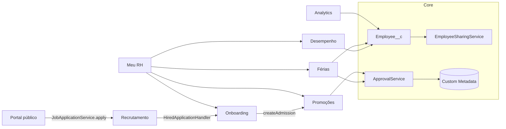
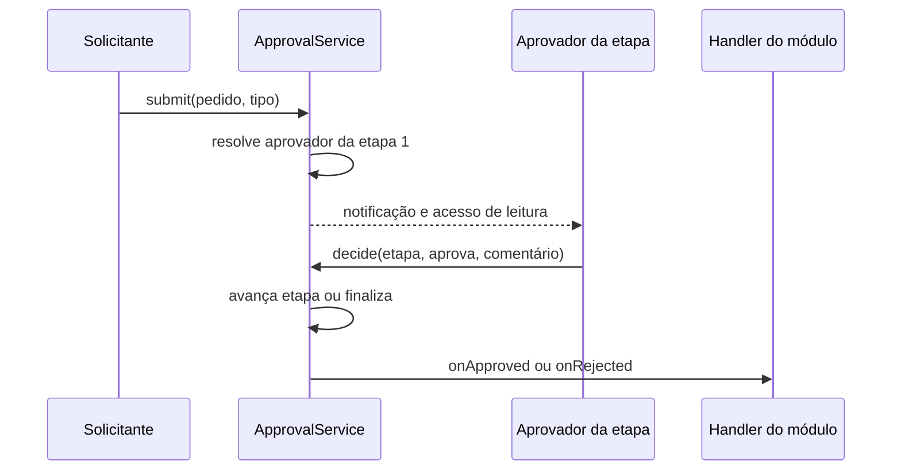
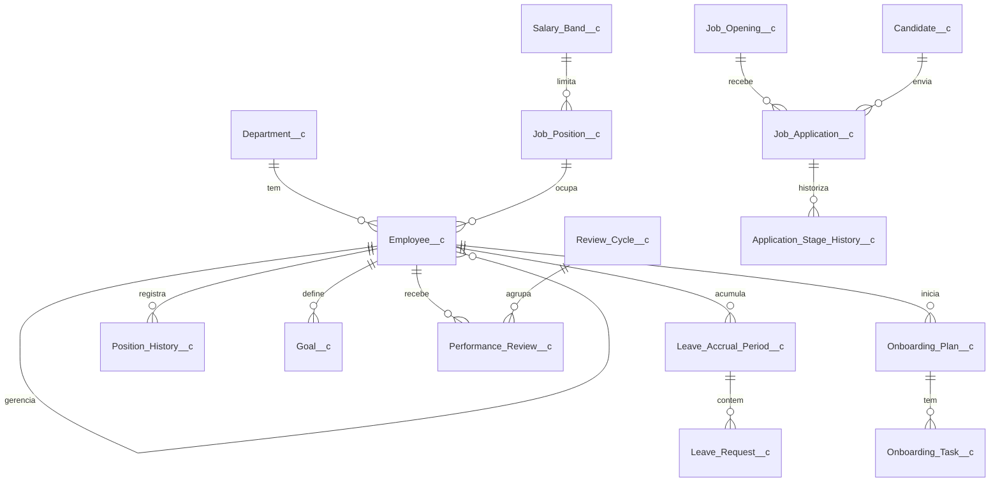

# RH Core: gestão de pessoas no Salesforce, da vaga à promoção

Produto de RH instalável (unlocked package) para empresas brasileiras: estrutura organizacional, férias pela CLT,
promoções, recrutamento com portal público de vagas, admissão, onboarding e avaliação de desempenho.

[](https://github.com/witorlomazzi/rh-core/actions/workflows/ci.yml)

> Projeto demonstrativo, com empresa e dados fictícios. Experiências profissionais reais não são publicadas por
> confidencialidade. As regras de férias seguem a CLT vigente com parâmetros configuráveis; convenção coletiva pode
> alterá-las e o produto não substitui orientação jurídica.

## O problema

Em empresas de porte médio, o RH vive em planilhas e e-mails: o saldo de férias é calculado à mão (e errado), a
promoção depende de quem lembrou de avisar a diretoria, o candidato some entre a caixa de entrada e o quadro de
vagas, e ninguém sabe ao certo quem pode ver o salário de quem. O custo aparece em multa trabalhista por férias
mal concedidas, em candidatos perdidos e em dado sensível circulando fora de controle.

## A solução, por módulo

| Módulo | O que resolve | Destaques |
|---|---|---|
| Core | Estrutura da empresa e acesso | Organograma navegável, hierarquia sem ciclos, compartilhamento por cadeia de gestores, motor de aprovação configurável |
| Férias CLT | Direito, saldo e solicitação | Doze regras validadas na hora, períodos aquisitivos automáticos, calendário de equipe com conflito, aprovação em duas etapas |
| Promoções | Mudança de cargo e salário | Fluxo gestor, gestor do gestor e RH; histórico de cargos; salário só para o RH |
| Recrutamento | Funil de candidatos | Kanban com etapas configuráveis, histórico de etapas, anonimização por LGPD |
| Portal de vagas | Candidatura pública sem login | Site Experience Cloud, DTO com campos permitidos, honeypot, tempo mínimo e limite diário |
| Onboarding | Da contratação ao primeiro dia | Colaborador em pré-admissão, plano com oito tarefas por papel, ativação com histórico de cargo |
| Desempenho | Ciclo de avaliação | Metas, autoavaliação, avaliação do gestor, calibração e liberação controlada |
| Meu RH | Experiência do colaborador e do gestor | Início por persona que reúne os componentes dos módulos |
| Analytics | Visão do RH | Sete relatórios e o painel do RH, mais dados de demonstração idempotentes |

## Arquitetura



Fluxo de aprovação (usado por férias e promoções, configurado em `HR_Approval_Step__mdt`):



Camadas de Apex: Controller fino (`@AuraEnabled`), Service com a regra de negócio, Selector com consulta em
`WITH USER_MODE`, um trigger por objeto chamando um Handler. Contexto de sistema só onde está documentado e comentado
no código (lista na seção de segurança).

## Modelo de dados (resumo)



São 25 objetos. Dado de pessoa é privado por padrão; filhos em master-detail herdam o acesso do colaborador. Regras
configuráveis ficam em Custom Metadata (parâmetros da CLT, etapas de recrutamento, etapas de aprovação e modelos de
onboarding).

## Segurança

Acesso vem de três fontes: o próprio registro, a cadeia de gestores (Apex Managed Sharing) e o RH (View All por
permission set). Salário e faixa salarial têm permissão de campo somente para o RH: não é só esconder na tela.

| Persona | Vê | Não vê |
|---|---|---|
| Colaborador | Os próprios dados, saldo e histórico de férias, autoavaliação, avaliação depois de liberada | Colegas, salário, promoções, candidatos |
| Gestor | Equipe direta e indireta, aprovações da própria cadeia | Outras equipes, salário |
| RH | Tudo, inclusive salário e calibração | n/a |
| Recrutador | Vagas, candidatos e candidaturas | Dados de pessoal |
| Gestor contratante | Candidaturas das próprias vagas | Candidatos de outras vagas |
| Candidato (sem login) | Vagas abertas e publicadas | Qualquer dado interno |

Permission sets por módulo e persona, agrupados em quatro Permission Set Groups (`HR_Employee`, `HR_Manager`,
`HR_Admin`, `HR_Recruiter`). Contexto de sistema permitido, sempre com comentário no código: criar e remover
compartilhamento, decidir etapa de aprovação, gerar períodos aquisitivos, snapshot de salário na promoção, controller
do portal para o convidado, anonimização por LGPD, criação do colaborador na admissão e lançamento do ciclo de
avaliação.

Testes de segurança em todos os módulos: colaborador A não vê colaborador B; gestor vê subordinado direto e
indireto; gestor não vê outra equipe; usuário sem permission set recebe exceção ou lista vazia; gestor não lê campo
de salário.

## Decisões técnicas e trade-offs

- **Motor de aprovação próprio em vez de Approval Process nativo.** O motor em Apex configurado por Custom Metadata
  permite etapas por tipo de pedido, aprovador resolvido pela hierarquia e testes unitários do fluxo inteiro. O custo
  é manter o código; o ganho é testabilidade e controle sobre quem pode decidir.
- **Compartilhamento por cadeia de gestores em vez de hierarquia de papéis.** A hierarquia de papéis do Salesforce
  é por usuário e não cobre colaboradores sem login. O caminho da hierarquia fica em `Hierarchy_Path__c` e o
  compartilhamento é recalculado em lote. O custo é o recálculo; o ganho é um modelo que funciona também para quem
  não tem usuário.
- **Custom Metadata para as regras da CLT.** Prazos, frações e tabela do art. 130 mudam por convenção coletiva e
  ficam configuráveis sem deploy.
- **Caminho da hierarquia limitado a 255 caracteres.** Texto longo não é filtrável por LIKE em SOQL. O limite
  comporta cerca de treze níveis; acima disso o serviço recusa com mensagem clara.
- **Site fora do pacote.** O Experience Cloud depende de configuração da org, então vive em `unpackaged/site`.
- **Controller do portal recebe JSON em texto.** O runtime LWR entregou parâmetro de classe Apex com todos os campos
  nulos; por isso o envio usa uma string JSON convertida no servidor. Foi um achado do site real que os testes Apex
  não pegam.

## Regras da CLT implementadas

Parâmetros em `HR_Setting__mdt` e `HR_Absence_Rule__mdt`; verifique a convenção coletiva da sua categoria.

| Regra | Base |
|---|---|
| Direito por faltas injustificadas (30, 24, 18 e 12 dias; acima de 32 perde o período) | art. 130 |
| Período concessivo de 12 meses após o aquisitivo | art. 134 |
| Fracionamento em até três períodos, um com 14 dias ou mais e os demais com 5 ou mais | art. 134 |
| Aviso prévio da concessão | art. 135 |
| Início vedado nos dois dias que antecedem feriado ou descanso semanal | art. 134, § 3º |
| Abono pecuniário de até um terço, requerido até 15 dias antes do fim do período | art. 143 |

Doze verificações (V1 a V12) com mensagem em português para cada uma; o aviso de conflito de equipe não bloqueia.

## Testes

Números recontados no repositório e na org de integração:

- Apex: 420 testes, 0 falhas, cobertura de 97% (`RunLocalTests` em scratch org com todos os módulos). Todas as
  classes do pacote acima de 85%.
- Jest (LWC): 241 testes em 30 suítes.
- Demo pública (regras em JavaScript): 62 testes Node.
- Salesforce Code Analyzer (`pmd:Recommended`): sem violação de severidade 1 ou 2.
- Tamanho: 142 classes Apex (49 de teste), 12 triggers, 30 componentes LWC, 25 objetos, 19 permission sets.

## Como instalar e rodar

Pré-requisitos: Salesforce CLI, Node 20 ou superior e um Dev Hub.

```bash
npm install
sf org create scratch --definition-file config/project-scratch-def.json --alias rh-demo --duration-days 7 --target-dev-hub <seu-dev-hub>
sf project deploy start --source-dir force-app --target-org rh-demo
bash scripts/seed-vetra-rh.sh rh-demo --agendar
npm run test:unit
sf apex run test --test-level RunLocalTests --code-coverage --target-org rh-demo --wait 60
```

O seed é idempotente: pode rodar mais de uma vez sem duplicar dados. Os personagens e cenários estão em
`docs/execucao/DEMO.md`. O site público de vagas (opcional) está em `unpackaged/site`; veja
`docs/execucao/modulos/portal.md`.

## Roteiro de demonstração

- Na org: `docs/execucao/DEMO.md`, dez passos por persona (colaborador, gestor, RH e recrutador).
- No navegador, sem org: abra `demo/index.html`. É uma simulação em HTML, CSS e JavaScript que reproduz as regras do
  produto com as mesmas personas, incluindo o portal de vagas e o painel do RH. Roteiro em `demo/ROTEIRO.md`.

## Por onde começar a ler o código

1. `docs/specs/` (visão geral, modelo de dados, segurança, convenções).
2. `force-app/core/classes/ApprovalService.cls` e `EmployeeSharingService.cls`: o coração do produto.
3. `force-app/leave/classes/LeaveRuleEngine.cls`: regras puras, sem consulta nem DML.
4. `force-app/portal/classes/JobPortalController.cls`: o único ponto de acesso do usuário convidado.
5. Relatórios de cada módulo em `docs/execucao/modulos/`.

## Limitações e próximos passos

- Escopo: sem folha de pagamento, ponto, eSocial, benefícios, integrações externas, currículo por upload no portal,
  login de candidato e app mobile nativo.
- Os componentes de tela foram verificados por testes Jest e deploy; a validação visual completa em navegador é
  parcial (portal e demo pública foram vistos no navegador).
- O site de vagas roda em uma scratch org e expira com ela.
- Trocar o gestor de um colaborador depois do lançamento do ciclo de avaliação não recalcula o avaliador nem o
  compartilhamento.
- A convenção coletiva de cada categoria pode alterar as regras de férias; ajuste os parâmetros antes de usar.

## Licença

A definir pelo autor antes de abrir o repositório ao público.
